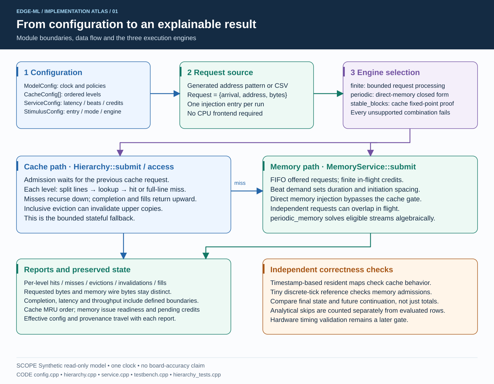
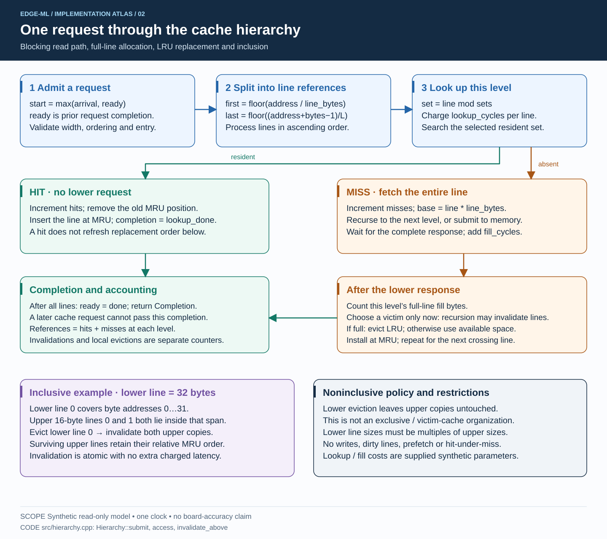
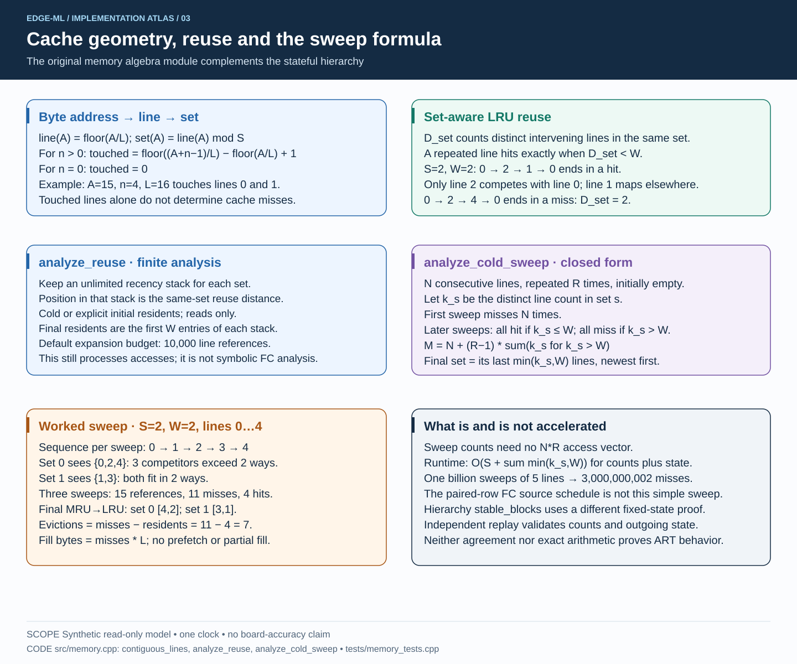
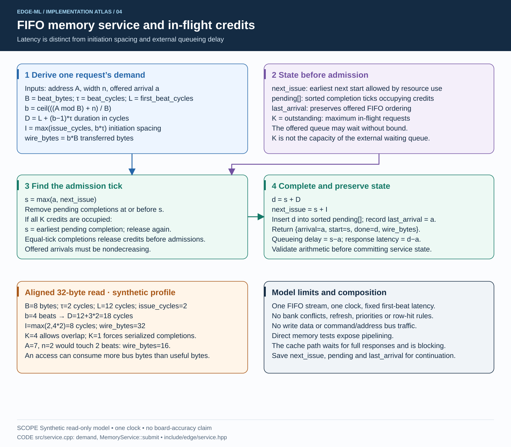
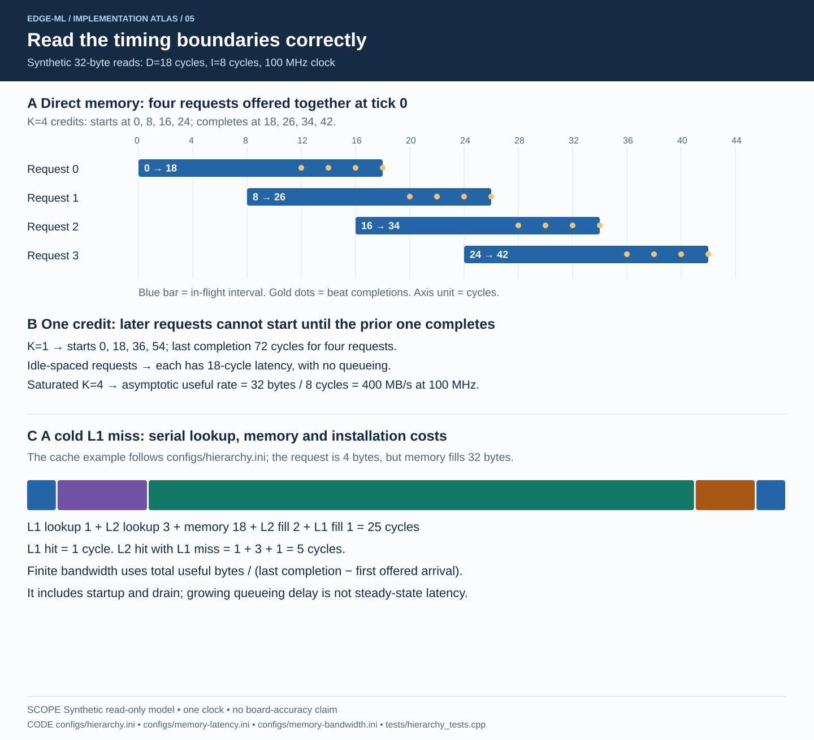
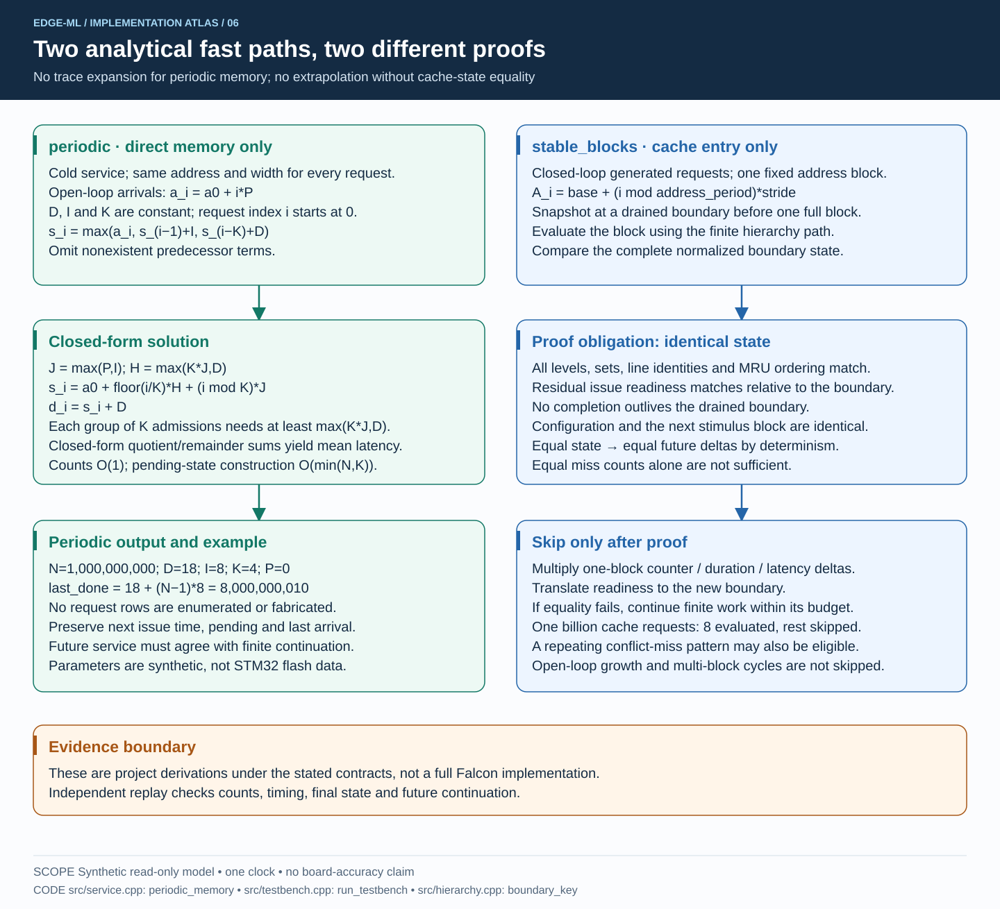
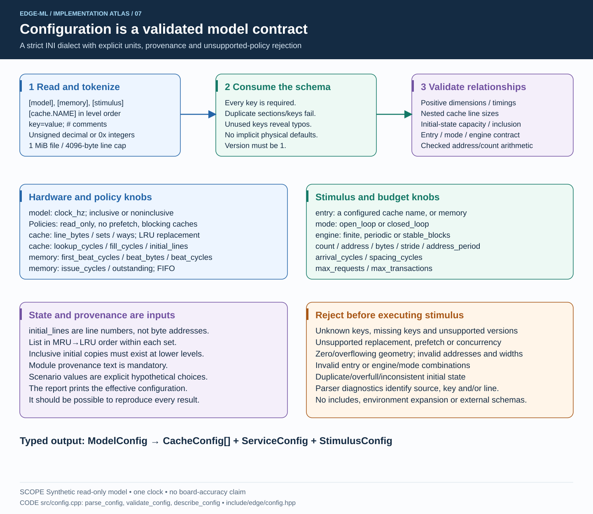
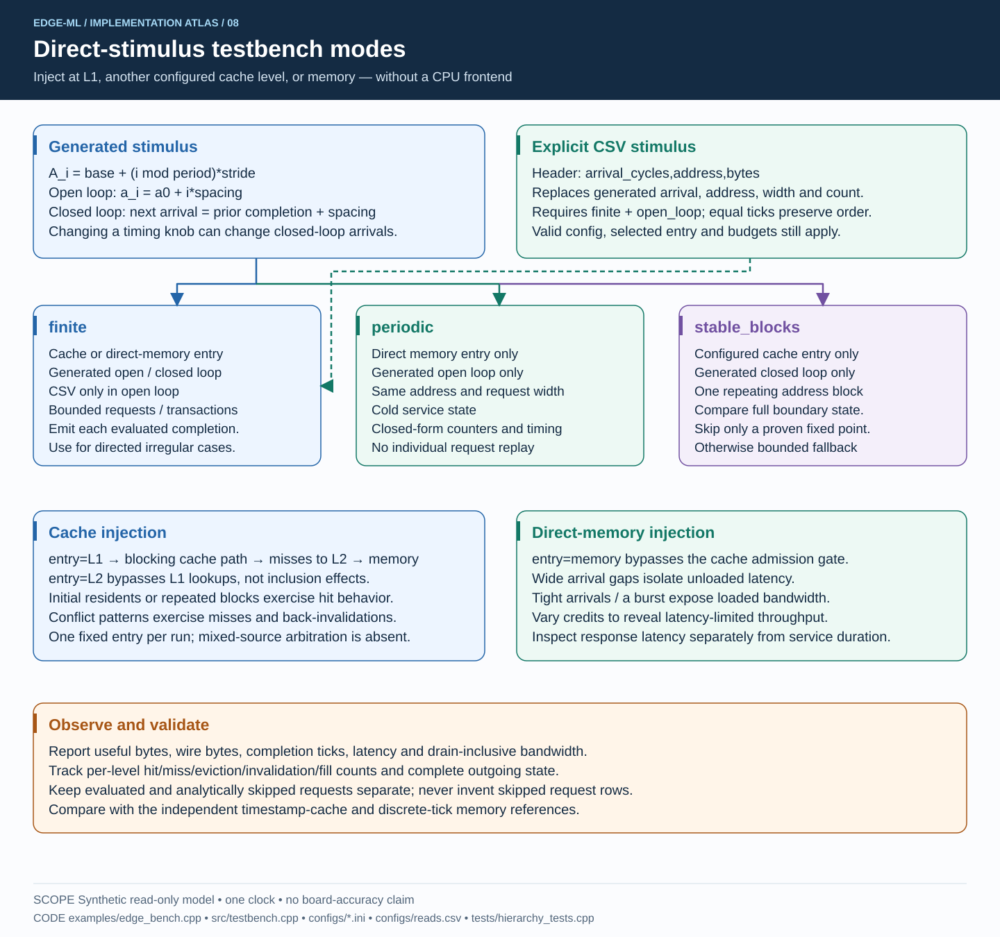
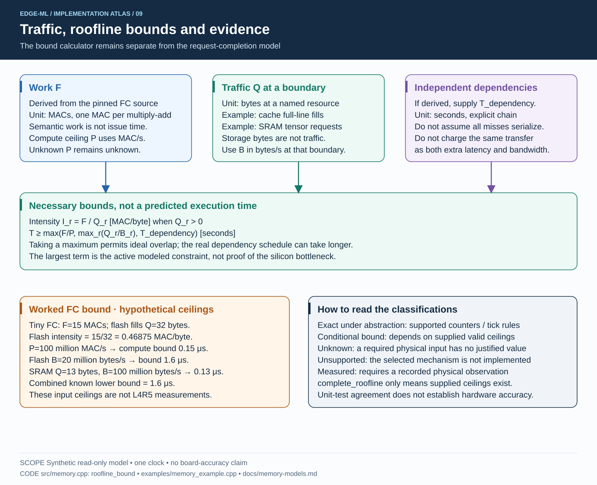
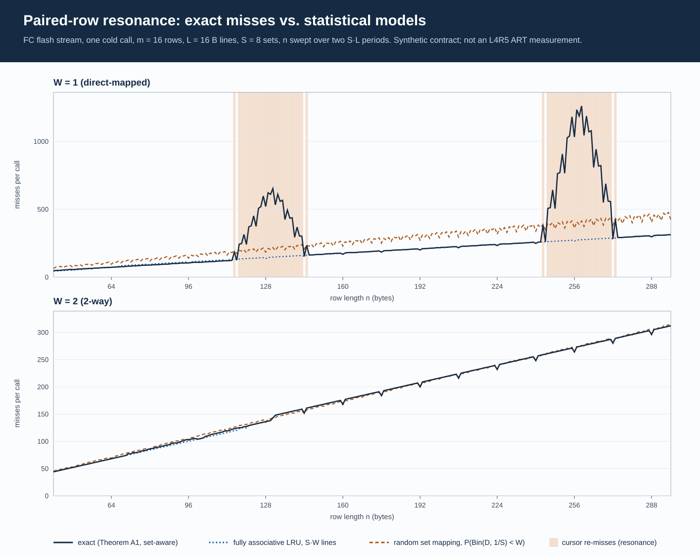

# Cache hierarchy and memory model: visual study guide

These nine SVGs describe the current implementation. Read them in order for a full
walkthrough, or jump to a module below. Open an SVG directly to zoom without losing
sharpness; text remains selectable and the files contain no external fonts, scripts
or raster images. All numerical timing examples use **synthetic parameters**.

The authoritative details remain in the [hierarchy/service contract](hierarchy-service-contract.md),
[configuration reference](configuration.md) and [memory mathematics](memory-models.md).
These figures illustrate the code as implemented, including its restrictions; they
do not depict a verified L4R5 ART microarchitecture or a full Falcon implementation.

| Figure | What to study | Implementation |
|---|---|---|
| [01 — System map](diagrams/01-system-map.svg) | Configuration, requests, engines, models and evidence | `config.cpp`, `testbench.cpp` |
| [02 — Cache hierarchy](diagrams/02-cache-hierarchy.svg) | Blocking admission, hits, recursive fills, LRU and inclusion | `hierarchy.cpp` |
| [03 — Cache mathematics](diagrams/03-cache-mathematics.svg) | Address geometry, same-set reuse, cold repeated sweeps | `memory.cpp` |
| [04 — Memory service](diagrams/04-memory-service.svg) | Beat demand, admission readiness, credits and completion | `service.cpp` |
| [05 — Timing examples](diagrams/05-timing-examples.svg) | Pipelined requests versus serial cache miss completion | `service.cpp`, sample configs |
| [06 — Analytical acceleration](diagrams/06-analytical-acceleration.svg) | Periodic closed form versus complete-state fixed-point proof | `service.cpp`, `testbench.cpp` |
| [07 — Configuration](diagrams/07-configuration.svg) | Parsing, semantic validation, knobs, provenance and rejection | `config.cpp` |
| [08 — Testbench](diagrams/08-testbench.svg) | Generated/CSV stimulus, injection points and engine restrictions | `testbench.cpp`, `edge_bench.cpp` |
| [09 — Roofline and evidence](diagrams/09-roofline-and-evidence.svg) | Traffic boundaries, conditional bounds and claim limits | `memory.cpp` |
| [10 — FC approximation study](diagrams/10-fc-approximation.svg) | Exact FC misses against fully associative and random-set models; paired-row resonance | `fc_cache.cpp`, `cache_approx.cpp` |

## 01. Start with the module boundaries

Follow a request from configuration to its result. The testbench selects a fixed
injection entry and an engine. The cache path is blocking; direct memory injection
can pipeline. The independent reference implementations live in tests, not inside
the analytical evaluator. See [the interfaces](../include/edge/testbench.hpp).



## 02. Follow one cache request

Trace a miss downward and its completion upward. The victim is selected **after**
the lower response because lower-level replacement can invalidate upper contents.
For a crossing read, the hit/miss logic applies to each touched line in ascending
order. Inclusive invalidations have no separate timing cost in this contract.
See [the cache implementation](../src/hierarchy.cpp).



## 03. Separate address counting from miss counting

A crossing access touches multiple lines, but its miss count depends on state.
Work through `0,2,1,0` versus `0,2,4,0` for two sets and two ways. Then derive the
repeated-sweep example: overflowing sets miss on every later sweep while fitting
sets hit. The displayed sweep equation assumes N>0 and R>0; if either is zero,
all counts are zero and the cold state stays empty. See [the algebra](../src/memory.cpp).



## 04. Derive one memory request

Calculate beats before calculating time. Then distinguish offered arrival,
admission and completion. A request can wait for issue readiness or for a credit;
these are distinct constraints. Pending completion ticks describe in-flight work,
not the externally waiting queue. See [the memory service](../src/service.cpp).



## 05. Read the timing examples

The first timeline shows four simultaneous offers with four credits. Bars show
in-flight duration; dots show beat completions. With only one credit, the same
requests must complete serially. The second example shows why a cold L1 request
has a 25-cycle response under the sample config even though memory's duration is
18 cycles. Run [the example profiles](../configs/) to inspect the corresponding counters.



## 06. Understand why skipping work is legal

The memory engine solves a regular recurrence with constant demand. The cache
engine instead evaluates complete blocks until their boundary state repeats.
These are different proofs. Cache contents, replacement order and residual issue
readiness must match; similar hit rates cannot justify a skip. Compare
[periodic_memory](../src/service.cpp) with [run_testbench](../src/testbench.cpp).



## 07. Treat the configuration as part of the experiment

Look at the hardware knobs separately from stimulus knobs. Every supplied profile
is explicit about units and provenance. The parser rejects settings it cannot
implement instead of accepting and ignoring them. Cache section order determines
hierarchy order. See [the complete schema](configuration.md).



## 08. Choose the testbench mode

Use finite evaluation for arbitrary directed input, periodic memory for eligible
regular loads, and stable blocks for repeated closed-loop cache patterns. CSV is
restricted to finite open-loop mode. Direct L2 injection bypasses L1 lookup, but
inclusive lower evictions can still invalidate L1 contents. For unloaded latency,
leave idle time between requests; for loaded bandwidth, reduce offered spacing.
See [the CLI adapter](../examples/edge_bench.cpp) and [directed CSV](../configs/reads.csv).



## 09. Keep a bound separate from a completion prediction

Roofline needs work and traffic at a defined resource boundary, plus valid ceilings.
It provides a necessary bound under those inputs, not the memory-service model's
completion schedule. The hypothetical FC example yields 1.6 microseconds as a
lower bound; this is not a measured or predicted board time.
See [the worked FC memory example](../examples/memory_example.cpp).



## 10. Set mapping decides the FC stream's misses

The direct-mapped panel plots, against the row length `n`, the cold-call misses of the
FC flash stream from three models:
- the exact set-aware count (Theorem A1);
- a fully associative LRU of the same capacity;
- the random-set-mapping model.

Within about one line of each multiple of `S·L` the two row cursors share a set and the
exact count jumps to up to 4.6 times the fully associative one. Neither statistical
model can show this.

The data is a plot of the analyzers, not a measurement. The figure is drawn from
[fc-approximation-L16-S8-m16.csv](data/fc-approximation-L16-S8-m16.csv) by
[plot_fc_study.py](../scripts/plot_fc_study.py), and §5 of
[fc-cache-theorem.md](fc-cache-theorem.md) discusses it.



## Maintaining the figures

The SVGs are checked-in documentation artifacts. Their editable source is
[generate_model_diagrams.py](../scripts/generate_model_diagrams.py), which uses only
the Python standard library:

```sh
python3 scripts/generate_model_diagrams.py
```

Update diagram text and equations when their model contracts change, regenerate,
then render and visually inspect the SVGs. Generation checks card height and XML
well-formedness; visual review is still needed for arrows and text placement.
The initial nine figures were rendered and inspected, including the timing and
testbench figures at full resolution. Figure 10 is generated from study data by
`scripts/plot_fc_study.py` (`fc_cache_study > csv`, then the script) and was rendered
with headless Edge and inspected. No simulator behavior changed in this update.
